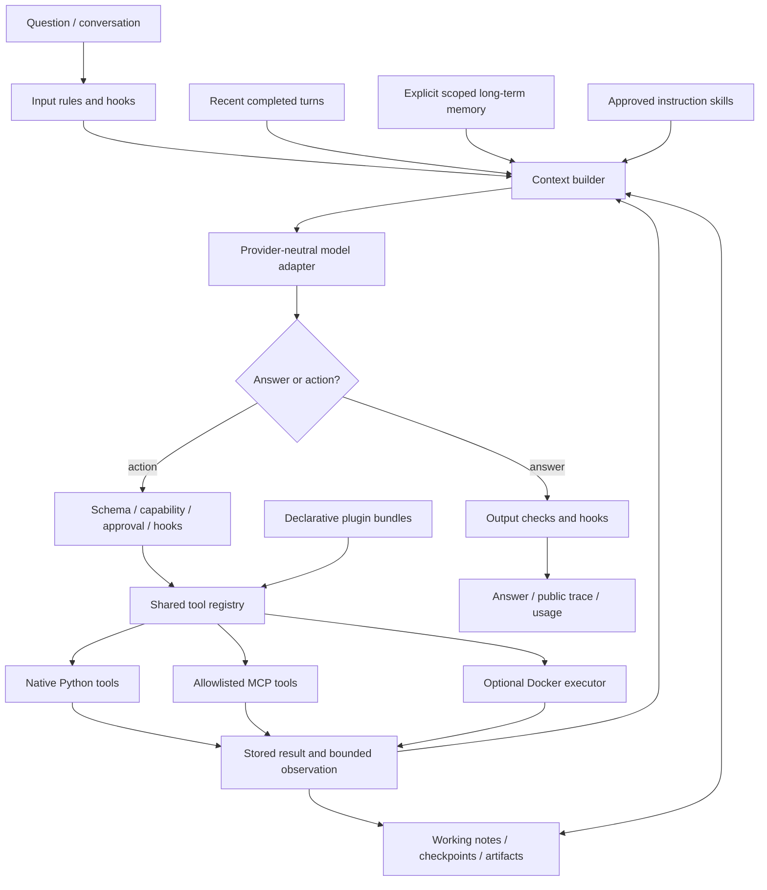

# Agent Foundry

**An inspectable agent harness: a model chooses actions; the runtime controls tools, state, permissions and evidence.** Fieldnote is the first application example, using fictional research-station measurements and reports.

This is an early portfolio prototype that runs locally. The core is newly authored and provider-neutral; it is not a model-training framework or a hosted service.

For a file-by-file and function-by-function tour, start with [the code walkthrough](docs/CODE_WALKTHROUGH.md). VS Code workspace settings select the local environment and pytest. In **Run and Debug**, choose a zero-API demo preset, set a breakpoint in `Runner._drive`, and press F5 to inspect each transition.

## Run the zero-API demo

Requirements: Python 3.11+ on macOS/Linux or Windows through WSL. No GPU or Docker is required for the basic example.

```sh
git clone https://github.com/sameerkini/agent-foundry.git
cd agent-foundry
bash setup.sh
.venv/bin/foundry demo
.venv/bin/python -m pytest -q
```

If your default interpreter is older, use `PYTHON=/path/to/python3.13 bash setup.sh`. Setup installs locked dependencies in an isolated environment. The demo uses a deterministic model fixture to call real read-only SQL and report tools. It is explicitly labeled and is not an accuracy benchmark.

For fresh model inference, copy `.env.example` to `.env`, fill in a provider base URL, API key and model available to your account, then run:

```sh
.venv/bin/foundry chat "How many readings were suspect, and what does the quality protocol say?"
```

The provider must support OpenAI-compatible chat/tool calls. Credentials remain in ignored local configuration. Selected context and tool definitions are sent to your provider; native evidence and memory stores stay local. `REASONING_EFFORT` is optional and only appropriate if your provider supports it.

## The harness loop

```text
validate input
load scoped memories and recent completed turns
while time, steps and tool budget remain:
    build bounded context, preserving complete tool exchanges
    ask the model for a final answer or typed tool requests
    for each requested action:
        validate arguments and check capabilities/hooks
        pause for exact-action approval if it has side effects
        execute the native, MCP or isolated-runtime tool
        store the full result; return a bounded artifact-linked observation
        checkpoint public working state and action events
validate final output, save the completed turn, return answer and trace
```



## What is implemented

| Layer | v0 behavior | Boundary |
|---|---|---|
| Model contract | Async provider-neutral response/tool-call interface, OpenAI-compatible adapter and scripted fixture | Provider-specific tool/reasoning compatibility needs live verification |
| Agent loop | Step/tool/time budgets, typed action dispatch, request-local read-only result reuse, durable run state | A bounded agent; no claim of unlimited autonomy |
| Tools | Shared native/plugin/MCP registry; filesystem reads, artifact paging, public working notes and scoped memory operations | Native Python handlers are trusted host code, not sandboxed |
| Guardrails/hooks | Input/output/model/tool/run lifecycle hooks, regex checks, schema validation and capability gates | Regex cannot establish semantic truth or defeat every prompt injection |
| Approvals | Side-effecting actions pause; resumption binds to exact arguments, run and runtime fingerprint | This is a local-user prototype, not multi-tenant authorization |
| Context | Character-bounded complete-turn/tool-group compaction; full results remain addressable artifacts | Character measurement is not tokenizer-exact accounting |
| Working memory | Current notes, artifacts and checkpoints | Public task state; no hidden chain-of-thought collection |
| Optional reasoning scaffold | Public task parts, evidence coverage review and a review bound to the exact final draft | Off by default; bookkeeping checks do not certify semantic correctness |
| Long-term memory | Explicit scoped facts/preferences with provenance, TTL, retrieval and deletion | No automatic conversion of tool output into trusted memory |
| Skills | Discover metadata, then load host-approved Markdown instructions | Instructions do not execute code or grant permissions |
| Plugins | Declarative manifests select approved tool factories and skill resources | No arbitrary import/install hook or self-granted capability |
| MCP | SDK2 stdio/HTTP adapter, explicit tool allowlists, namespacing, bounded observations | Local stdio peers are approved host processes, not a sandbox |
| Execution runtime | Optional Docker Python executor with isolated input snapshots, no network, non-root user and resource limits | No Docker installation here; actual container isolation remains unverified |
| Fieldnote example | Newly authored synthetic data, read-only SQL, report search and evidence-referenced calculations | Existing standalone Fieldnote UI is not yet wired to this core |

## Memory and approval examples

Long-term writes happen only through an explicit CLI command or an authorized/approved tool. They do not happen just because a model saw a fact.

```sh
.venv/bin/foundry memory add --key writing-style --text "Prefer concise explanations" --ttl 86400
.venv/bin/foundry memory search --query explanations
.venv/bin/foundry memory forget --key writing-style
```

Model-requested memory writes need `--allow memory.write`. They pause before execution and return the exact action ID:

```sh
.venv/bin/foundry chat "Remember that I prefer concise explanations" --allow memory.write
.venv/bin/foundry resume RUN_ID --approve ACTION_ID --allow memory.write
.venv/bin/foundry trace RUN_ID
```

A changed runtime/configuration invalidates old approval checkpoints. The current fingerprint is conservative: mutable handler closure state can also invalidate a legitimate resume; keep changing state in ToolContext and capture immutable configuration. Uncertain side effects require reconciliation and are not blindly retried. Standard thread cancellation cannot stop arbitrary trusted synchronous Python code; untrusted code belongs in the isolated executor.

All state is local under ignored `.foundry/`. Memory is neither encrypted nor immutable. Treat scope identifiers as local project boundaries, not authenticated user identities.

## Try the real local MCP protocol

```sh
.venv/bin/python examples/mcp_demo.py
```

This starts an explicitly approved local MCP server, discovers one allowlisted tool, calls it through the ordinary runner and closes the connection. It uses a scripted model, no API key and no web service. Remote MCP can be configured through `MCPConfig(url=...)`; externally hosted servers have not been tested in this milestone.

The installed SDK is pinned through `uv.lock`. The adapter follows the current MCP SDK2 client interface. See [MCP client documentation](https://py.sdk.modelcontextprotocol.io/client/).

## Optional isolated execution

`DockerSandbox().tool()` registers the Python runtime tool. The application must explicitly grant `code.execute` and approve the proposed action. If Docker or the configured local image is unavailable, execution fails closed; there is no host-Python fallback. Do not expose the Docker socket or mount ambient home/project directories containing credentials.

The Docker tests inspect constraints and failure behavior; the actual engine integration test is skipped until Docker is available. See [Docker execution guidance](https://docs.docker.com/engine/containers/run/).

## Reasoning, training and the future transformer

The loop supports a ReAct-style action/observation workflow without demanding hidden chain-of-thought. The optional `plan-review` scaffold adds a concise public task plan before tool work and a coverage review before release. That review refers to actual run artifacts and must match the final draft; new tool work makes it stale. These are workflow checks, not an independent proof that the answer follows from its evidence.

```sh
.venv/bin/foundry demo --reasoning plan-review
.venv/bin/foundry chat "Compare valid readings across stations and explain quality caveats." --reasoning plan-review
.venv/bin/foundry chat "Count the readings." --reasoning off
```

The default is `off`; `REASONING_SCAFFOLD=plan-review` can set a local preference. This is independent of provider `REASONING_EFFORT`: disabling the scaffold does not disable a model's internal reasoning, its tools, or ordinary policy checks. Explicit planning/review can add model exchanges and tokens. Compare both modes on matched questions before assuming it improves quality. See [reasoning design](docs/REASONING.md).

The provider-neutral `Model` protocol is the connection point for your future transformer, provided it can emit the tool-call contract. The current adapter uses Chat Completions; providers/models that require a Responses-specific tool protocol need a separate adapter.

**Deferred:** a DPO training pipeline. First establish trustworthy evaluations, then collect reviewed chosen/rejected responses or trajectories with consent and provenance. Training also requires trainable weights and a suitable reference/trainer setup; a harness cannot fine-tune an arbitrary remote endpoint by itself.

## Validation and release status

Software tests, scripted end-to-end runs and actual local MCP protocol tests are separate from model-quality evaluations. No paid provider calls or broad accuracy claims are included in this milestone. Docker runtime execution and remote MCP/model compatibility remain unverified. See [architecture](docs/ARCHITECTURE.md), [roadmap](docs/ROADMAP.md) and [validation](docs/VALIDATION.md).

Next milestones are live provider validation, real Docker execution, matched answer-quality evaluations, and an optional Fieldnote UI adapter. See [provenance](docs/PROVENANCE.md) for code/data origin, AI assistance and licensing status. The repository excludes local credentials, private runtime state and unrelated application materials.
