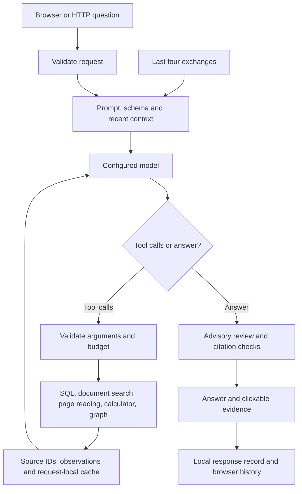
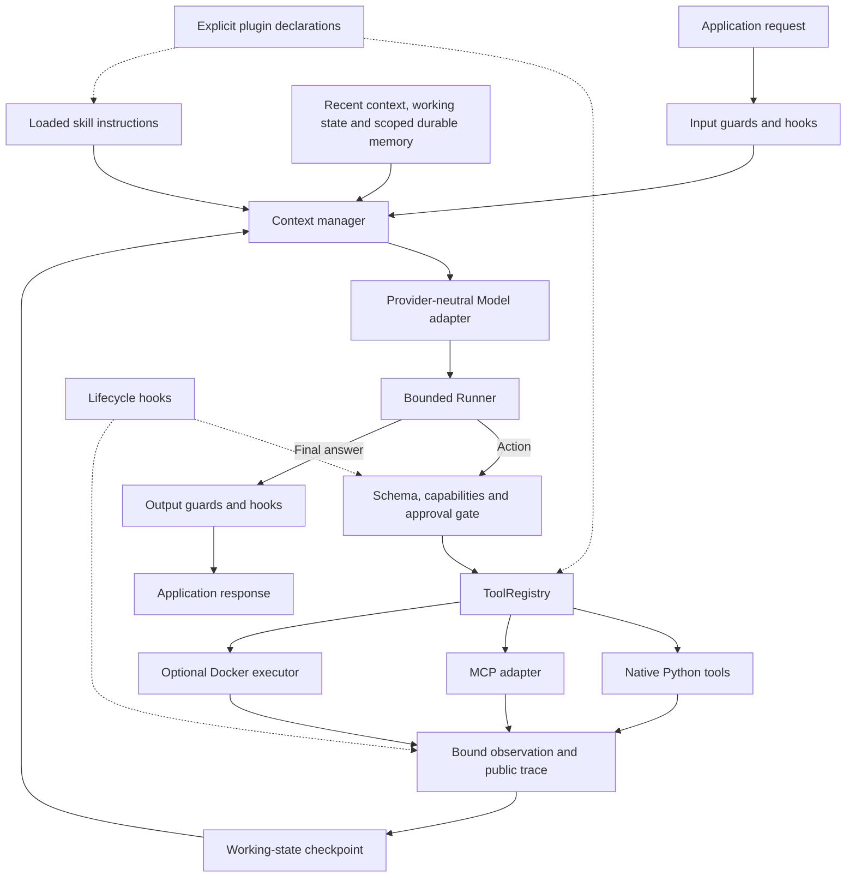

# Agent Foundry architecture

Agent Foundry separates the model that chooses actions from the software that permits, executes and records those actions. Fieldnote is the first domain example: research-station tables and reports supply its evidence, while the core should work with other applications.

This document distinguishes the original standalone Fieldnote implementation from the new core's implemented v0 contracts. The README and validation record identify what was exercised: deterministic model fixtures call real native tools, and a local MCP-server demonstration checks the protocol. Remote model/provider compatibility and actual Docker-container isolation still require live validation.

## The Fieldnote harness we started with



Its existing loop is approximately:

```python
def answer(question, recent_chat):
    if no_model_connection():
        return clearly_labelled_evidence_preview()

    messages = prompt + database_schema + recent_chat[-4:] + question
    evidence, plan, trace, reused_results = empty_run_state()

    while rounds_and_time_remain():
        reply = model(messages, available_tools)
        if reply.has_no_tool_calls():
            draft = reply.text
            break

        append_assistant_message(reply)
        for call in reply.tool_calls:
            validate_schema_and_remaining_tool_budget(call)
            observation = reuse_identical_call_or_execute(call)
            attach_source_ids(observation, evidence)
            append_tool_reply(observation)  # errors are observations too

    draft = synthesize_from_existing_evidence_if_needed(draft)
    final = advisory_review(draft, question, plan, evidence)
    validate_citation_ids_and_exact_quotes(final, evidence)
    save_public_response_and_return(final)
```

The model may plan, clarify, query SQL, search documents, read a page, calculate or explore relationships. Python performs the actual work. Review can still misunderstand evidence; an existing quotation does not certify the claim beside it.

Fieldnote already has request-local working state and persisted display history. It does not have an active long-term-memory retrieval system, skill loader, general plugin registry, MCP connection or execution sandbox. Its direct tools run in the host process.

## The reusable v0 core



The main contracts are small: `Model` returns text and typed `ToolCall` objects; `ToolRegistry` owns definitions and handlers; `ToolContext` carries the workspace, run/session IDs and application services; `RunConfig` supplies budgets and allowed capabilities; `RunResult` exposes status, answer, trace, usage and pending approvals.

The implemented control flow is approximately:

```python
async def run(request):
    input_guards.check(request)
    state = fresh_working_state_for_this_run()
    history = load_completed_turns(request.workspace, request.scope, request.session)

    while budget.permits_another_step():
        context = context_manager.build(request, history, state, skills, memories)
        reply = await model.respond(context, registry.allowed_definitions())

        if reply.is_final():
            return output_guards.check_and_record(reply, state)

        for action in reply.calls:
            tool = registry.resolve(action.name)
            validate(action.arguments, tool.schema)
            policy.check(tool.capability, action.arguments)
            if approval_is_needed(action):
                return pending_approval_without_execution(action)
            before_tool_hooks.check(action)
            result = await bounded_executor.execute(tool, action)
            observation = after_tool_hooks.validate_and_bound(result)
            state.record(action, observation)
            checkpoint(state)

    return explicit_budget_exhaustion_or_supported_partial_result(state)
```

An ordinary request starts fresh working state. The explicit `resume` path restores an approval-paused run, checks the saved runtime/configuration fingerprint, and accepts only approvals bound to the exact pending action. Completed conversation turns are saved only after final release checks succeed. Arbitrary crash recovery or automatic replay of uncertain side effects is not implemented.

The conservative runtime fingerprint includes common captured handler values. Mutable lists or caches captured by a handler can therefore invalidate a later approval checkpoint even when its code did not change. Prefer immutable captured configuration and keep changing task state in `ToolContext`; an invalidated checkpoint requires review rather than an automatic retry.

This is a public action/observation loop, often described as ReAct-style orchestration. It does not require extracting, storing or displaying private model chain-of-thought. Plans, tool arguments, observations and decision summaries are sufficient for inspection.

## What the extension terms mean

| Component | Meaning | Boundary |
|---|---|---|
| Tool | An executable action with an input schema and declared capability | The runner validates and authorizes execution |
| Skill | Instructions and resources for a task | Loading instructions does not grant execution permission |
| Plugin | A declarative bundle of tools, skills and configuration | Installation does not automatically approve its capabilities |
| MCP | A standard connection protocol for discovering and calling tools | Local and remote MCP tools still pass through core policy |
| Sandbox | A constrained execution environment | A plain host subprocess is not a sandbox |
| Model adapter | A common interface around a model/provider | It separates inference from the agent's data and tools |

Native, MCP and sandbox-backed tools use the same registry and observation contract. MCP transports do not themselves provide isolation: starting a local MCP server is a trusted process launch unless a separate execution boundary constrains it. The optional Docker executor checks availability and configured restrictions; a missing engine fails rather than falling back to host execution. Native synchronous Python handlers are trusted host code: cancelling an await cannot terminate an arbitrary running thread, so an uncertain side effect requires manual reconciliation.

## Three different kinds of memory

**Context** is the bounded material in the next model request. v0 uses character budgets and bounded observations; these are approximate controls, not tokenizer-exact accounting. System instructions and complete tool-call/result relationships need to survive compaction.

**Working memory** is structured state for the current task: notes, artifacts, completed actions and pending work. Checkpoints preserve it for inspection and explicit approval resumption; fresh tasks do not automatically inherit it. It is distinct from the model's hidden reasoning.

**Long-term memory** deliberately retains information for retrieval in later tasks. SQLite records have project scope, provenance, timestamps, optional expiry and deletion. The current search baseline uses literal token overlap, not vector memory. Workspace and explicit scope namespace records; completed-turn history also includes the session. These are local application boundaries, not authenticated user identities. Untrusted document content does not automatically become trusted memory.

Fieldnote's database, unit rules, document eligibility, graph relationships and citation policy belong in domain adapters, not the generic core. The current core example adapts synthetic data, read-only SQL, report search and source-referenced calculations through a plugin. The original Fieldnote browser UI, full graph workflow and answer-review interface have not been rewired to the new core. Evaluation references remain outside model context and memory.

## Future transformer connection

The `Model` protocol allows a future adapter to call a locally trained transformer instead of a hosted endpoint. The model must still produce reliable tool-call structures, and the harness must still enforce policy. Plugging in model weights does not automatically teach tool use or make a weak model accurate.

A future preference collector can retain reviewed chosen/rejected public responses and action trajectories. Collection/export and actual DPO training are deferred until there is an owned/trainable model, suitable reviewed preferences and independent evaluation. A proposed data-export seam is not a completed training pipeline.
